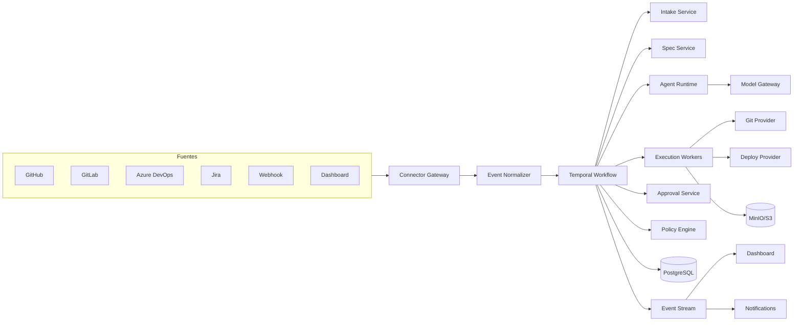

# 2. Arquitectura

## Vista general



## Componentes

### Connector Gateway

- Recibe eventos.
- Valida firmas y autorización.
- Aplica rate limiting.
- Deduplica mediante idempotency key.
- Conserva el payload original.
- Entrega un evento al normalizador.

### Event Normalizer

Convierte cualquier evento en un `WorkItemInput` común:

```json
{
  "source": "github",
  "eventType": "issue.created",
  "tenantId": "tenant-demo",
  "projectId": "project-api",
  "repository": {
    "provider": "github",
    "owner": "example",
    "name": "api",
    "defaultBranch": "main"
  },
  "request": {
    "externalId": "182",
    "title": "Añadir autenticación OIDC",
    "body": "Contenido original",
    "authorId": "external-user-id",
    "url": "https://example.invalid/issues/182"
  },
  "policyProfile": "production-standard"
}
```

### Workflow Engine

Temporal es dueño de las transiciones, reintentos, pausas, señales humanas y timeouts. Los agentes no modifican directamente el estado persistente.

### Policy Engine

Combina reglas del sistema, organización, proyecto y repositorio. Puede comenzar como reglas YAML validadas y evolucionar a Open Policy Agent/Rego.

### Agent Runtime

```text
CodingAgentProvider
├── ClaudeCodeProvider
├── CodexProvider
├── OpenCodeProvider
├── GeminiCLIProvider
└── CustomAgentProvider
```

Interfaz mínima:

- `prepare_workspace()`
- `run_task()`
- `stream_events()`
- `cancel()`
- `collect_usage()`
- `collect_artifacts()`
- `health_check()`

### Model Gateway

Abstrae Anthropic, OpenAI, Azure OpenAI, OpenRouter, LiteLLM, Ollama y vLLM. Debe ofrecer structured outputs, fallback, presupuesto, timeout y registro de uso.

### Git Provider

```text
GitProvider
├── GitHubProvider
├── GitLabProvider
├── AzureDevOpsProvider
├── BitbucketProvider
└── GenericGitProvider
```

Operaciones: issues, comentarios, ramas, commits, diff, Draft PR/MR, checks, reviewers, merge y cierre.

### Deploy Provider

```text
DeployProvider
├── DockerComposeProvider
├── KubernetesProvider
├── OpenShiftProvider
├── ArgoCDProvider
├── AzurePipelinesProvider
├── GitHubActionsProvider
└── GenericWebhookProvider
```

## Estructura del repositorio de la plataforma

```text
ai-code-factory/
├── apps/
│   ├── api/
│   ├── dashboard/
│   └── worker/
├── packages/
│   ├── domain/
│   ├── connectors/
│   ├── git-providers/
│   ├── deploy-providers/
│   ├── agent-providers/
│   ├── model-gateway/
│   ├── policy-engine/
│   ├── notifications/
│   └── observability/
├── workflows/
├── policies/
├── prompts/
├── schemas/
├── migrations/
├── tests/
├── deploy/
└── docs/
```

## Reglas arquitectónicas

- Dominio independiente de FastAPI, Temporal, GitHub y proveedores LLM.
- Adapters detrás de interfaces.
- Activities de Temporal idempotentes.
- Eventos de dominio persistidos antes de publicarse.
- Estado funcional en PostgreSQL; artefactos grandes en MinIO/S3.
- Redis no es la fuente de verdad.
- Cada ejecución se relaciona con un commit SHA exacto.
