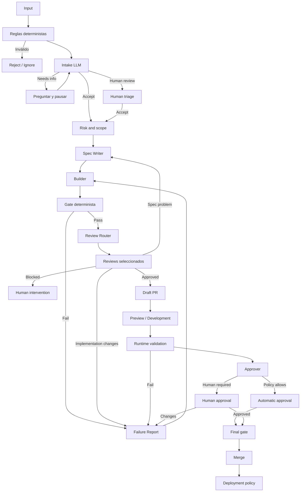

# 3. Workflow, estados y políticas

## Flujo principal



## Estados

- `RECEIVED`
- `NORMALIZING`
- `TRIAGE`
- `NEEDS_INFORMATION`
- `REJECTED`
- `WAITING_HUMAN_TRIAGE`
- `ACCEPTED`
- `SPEC_WRITING`
- `SPEC_REVIEW`
- `WAITING_HUMAN_SPEC`
- `BUILDING`
- `TESTING`
- `REVIEWING`
- `FIXING`
- `DRAFT_PR`
- `DEPLOYING_PREVIEW`
- `VALIDATING_PREVIEW`
- `WAITING_HUMAN_MERGE`
- `READY_TO_MERGE`
- `MERGING`
- `MERGED`
- `WAITING_HUMAN_DEPLOYMENT`
- `DEPLOYING_PRODUCTION`
- `COMPLETED`
- `BLOCKED`
- `FAILED`
- `CANCELLED`

## Intake híbrido

### Reglas deterministas previas

- Firma válida.
- Proyecto y repositorio autorizados.
- Evento no duplicado.
- Autor autorizado.
- Etiqueta o comando de activación válido.
- Sin ejecución activa equivalente.
- Estado de origen compatible.

### Salida del LLM

```json
{
  "decision": "ACCEPT",
  "confidence": 0.89,
  "type": "ui-change",
  "difficulty": "low",
  "risk": "low",
  "affectedSurfaces": ["frontend", "ui", "accessibility"],
  "missingInformation": [],
  "requiresHumanTriage": false,
  "requiresSpec": true,
  "suggestedReviewers": ["code", "ui", "accessibility"]
}
```

Umbrales iniciales configurables:

- Confianza menor de `0.65`: revisión humana.
- Entre `0.65` y `0.80`: continuar solo si hay criterios suficientes y ninguna regla eleva el riesgo.
- Mayor de `0.80`: continuar según política.

Los umbrales se calibrarán con métricas reales; no son garantías estadísticas.

## Política de aprobación automática

La aprobación automática requiere que se cumplan todas las condiciones, no una recomendación aislada del LLM:

```yaml
autoApproval:
  enabled: true
  allowedRisk: [low]
  allowedTypes: [documentation, ui-cosmetic, test-only]
  maxChangedFiles: 3
  maxChangedLines: 100
  maxRetries: 1
  forbiddenPaths:
    - auth/**
    - billing/**
    - migrations/**
    - infra/**
    - .github/workflows/**
  require:
    gate: passed
    reviewers: approved
    unresolvedFindings: 0
```

## Escalado humano obligatorio

- Autenticación o autorización.
- Facturación.
- Datos personales.
- Migraciones destructivas.
- Infraestructura de producción.
- API pública o breaking change.
- Vulnerabilidad alta o crítica.
- Baja confianza.
- Presupuesto excedido.
- Alcance real muy superior al estimado.
- Máximo de reintentos alcanzado.
- Conflicto entre criterios de aceptación.

## Reintentos

- Máximo 3 rondas de Build por defecto.
- Máximo 2 apariciones del mismo fingerprint sin cambio material.
- Un fallo técnico vuelve al Builder.
- Un problema de requisitos vuelve al Spec Writer.
- Un cambio de alcance o producto pausa para una persona.
- Todos los reintentos consumen un presupuesto y generan eventos.

## Orden de PR y despliegue

```text
Spec -> Build -> primer commit -> Draft PR
     -> Gates/Reviews -> Preview
     -> aprobación -> PR Ready
     -> sincronización con main -> Gate final
     -> Merge -> Development/Staging -> Producción según política
```

Una rama sin fusionar puede desplegarse en preview o namespace aislado. Producción recibe normalmente un commit fusionado y protegido.
